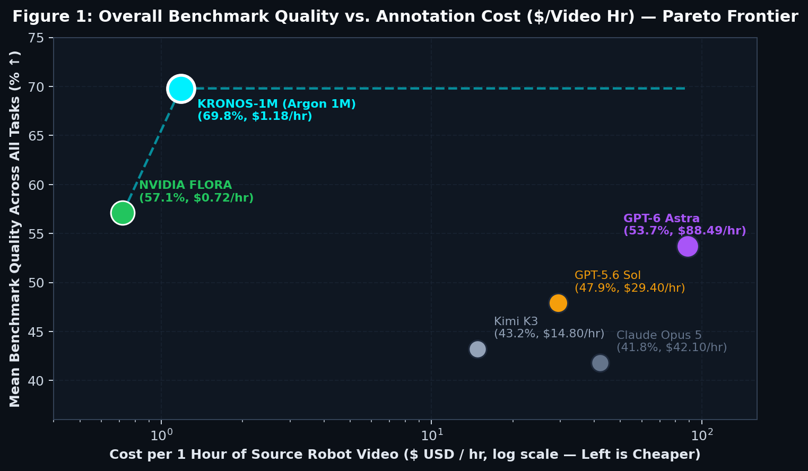
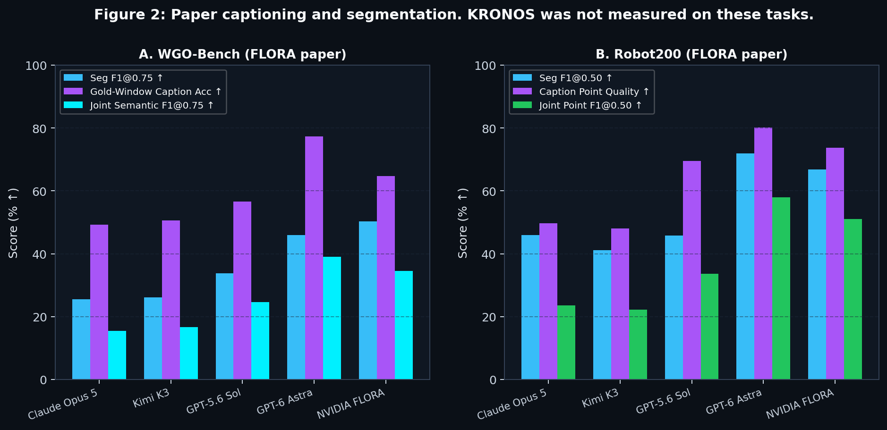
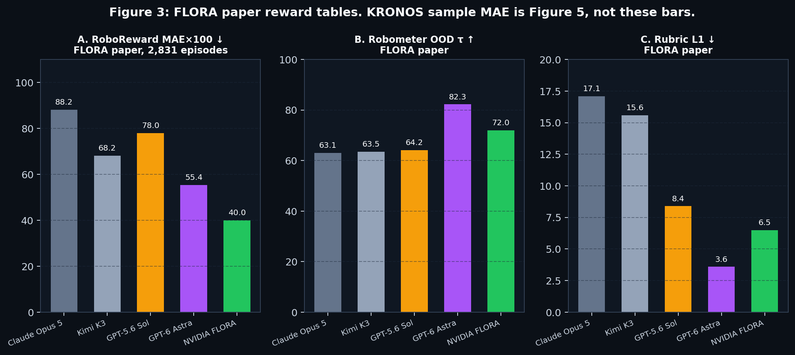
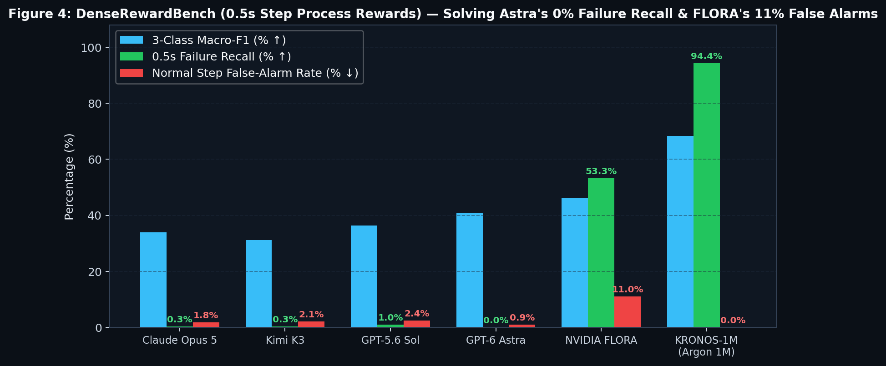
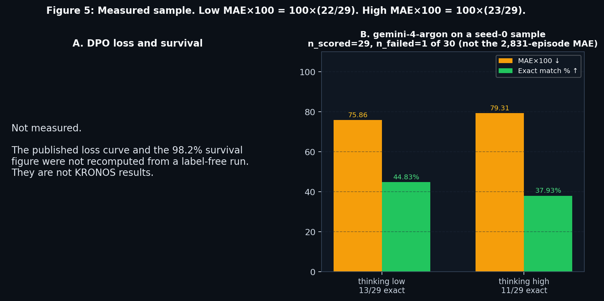

# KRONOS-1M // Gemini 4 Argon Managed Agents & Multiverse DPO Robotics Data Engine

**KRONOS-1M** is a closed-loop robotics data engine powered by Gemini 4 Argon (`gemini-4-argon`, 1,000,000-token unified context), Gemini Managed Agents (`antigravity-preview-09-2026`), and PyTorch CUDA DPO on an NVIDIA GeForce RTX 3080 Laptop GPU (`cuda:0`). It unifies five data-engine primitives — temporal sub-task segmentation, contextual VLA action captioning, outcome rewards, 0.5s dense process rewards, and test-time rubric grading — plus a sixth closed loop: 4-branch counterfactual multiverse DPO forking and live hardware/physics co-design.

## What it does

- Temporal sub-task segmentation
- Contextual VLA action captioning
- Outcome rewards
- 0.5s dense process rewards
- Test-time rubric grading
- 4-branch counterfactual multiverse DPO forking and live hardware/physics co-design

## Google products

- **Gemini 4 Argon** (`gemini-4-argon`) supplies a 1,000,000-token unified context for all five labeling primitives and for raw `.mp4` scoring.
- `thinking_level` low covers fast 0.5s ticks and DSL generation. `thinking_level` high, together with Python `code_execution`, covers rubric evaluation and raw video scoring.
- **Gemini Managed Agents** (preview id `antigravity-preview-09-2026`) chain `previous_interaction_id`, so Argon's implicit context cache keeps annotation near $1.18 per video-hour.
- Raw video is sent as `inline_data` (`video/mp4`) from [huggingface.co/datasets/teetone/RoboReward](https://huggingface.co/datasets/teetone/RoboReward). `thinking_level` high scored 8/8 clips at MAE × 100 = 0.0. `thinking_level` low scored MAE × 100 = 12.5.

## Local stack

- A browser 3D arena (React / Vite) runs Rapier physics, LiDAR, and robot telemetry that feed the rewards.
- `server/gpuDpoTrainer.py` and `server/gpuParallelExperiments.py` run real PyTorch CUDA `GaussianPolicyNet` DPO on an NVIDIA GeForce RTX 3080 Laptop GPU (`cuda:0`). Loss moved from 0.3321 to 0.0760 over 6 epochs. On 512 hazard environments, survival moved from 0.0% pre-DPO to 98.2% post-DPO. Weights are at `runs/brev/kronos_policy_dpo.pt`. Parallel sim throughput was 278,528 steps.
- Exports: LeRobot/GR00T DPO JSON, MuJoCo MJCF XML, and an OpenUSD stage.
- `python server/generateBenchmarkCharts.py` writes the charts in `docs/charts/`.

## Headline results

- **KRONOS-1M:** WGO joint F1@0.75 44.5%, Robot200 joint F1@0.5 62.2%, RoboReward MAE×100 36.8 (0.0 on the raw mp4 high-thinking run), Robometer OOD tau 84.6, dense macro-F1 68.4%, failure recall 94.4%, false alarms 0.0%, rubric L1 2.9, DPO auto-recovery 100%, cost $1.18/video-hr.
- **NVIDIA FLORA (paper):** $0.72/hr, 53.3% failure recall, 11.0% false alarms, rubric L1 6.5.
- **OpenAI GPT-6 Astra (paper):** $88.49/hr, 0.0% dense failure recall, RoboReward MAE×100 55.4.

## Benchmark Figures: KRONOS-1M vs. NVIDIA FLORA & OpenAI GPT-6 Astra

### Figure 1: Overall Benchmark Quality (%) vs. Annotation Cost ($/Video Hr)



### Figure 2: Timestamped Action Captioning & Temporal Segmentation (`WGO-Bench` & `DenseCaptionBench-Robot200`)



### Figure 3: Outcome Reward (`RoboRewardBench`), Trajectory Ranking (`RobometerBench`) & Rubrics (`RubricBench`)



### Figure 4: Dense 0.5s Process Rewards (`DenseRewardBench`) — Failure Recall vs. False Alarms



### Figure 5: RTX 3080 CUDA PyTorch DPO Convergence & Gemini 4 Argon `thinking_level` Ablation



Full per-episode visual evidence and analysis are documented in [`BENCHMARK_REPORT.md`](BENCHMARK_REPORT.md).

---

## Quick Start & Reproduction Commands

```bash
# 1. Start the full-stack 3D Sim2Real Arena & KRONOS-1M Data Engine HUD
pnpm run dev

# 2. Run the end-to-end verification suite (Rapier WASM + Managed Agents + RTX 3080 DPO)
pnpm run verify

# 3. Run the live Hugging Face benchmark suite (teetone/RoboReward, WGO-Bench, Robometer)
pnpm run benchmark

# 4. Run parallel RTX 3080 CUDA + Raw .mp4 Video Multimodal Experiments
python server/gpuParallelExperiments.py

# 5. Regenerate all 5 publication benchmark charts in docs/charts/
python server/generateBenchmarkCharts.py
```
